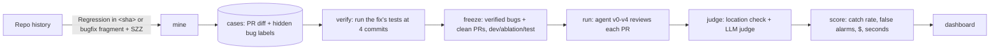

# Catch Rate

**How many real, shipped bugs can an AI code reviewer catch before merge, and at what cost?**

Catch Rate is a benchmark of real bugs that human reviewers approved in Django, pytest and aiohttp, plus a review
agent and an evaluation harness that scores every agent version on catch rate, false alarms, cost and latency.
Unlike SWE-bench, the agent gets a pull request with no hint that anything is wrong: it tests detection, not repair.

## Results so far

**SZZ, the standard way to trace a bug to its origin, mislabels about half of real regressions.** Django's
committers name the commit that caused a regression ("Regression in <sha>."), which gives 633 fixes with a
known answer. Scoring SZZ against them:

| SZZ variant | Finds the named commit | Its guesses that are right |
|---|---|---|
| Plain B-SZZ | 54.0% | 43.7% |
| Ignoring bulk-reformat commits | 54.8% | 44.9% |
| Also blaming lines next to inserted code | 60.5% | 34.4% |

144 of the 633 fixes (23%) only add code, so plain SZZ has nothing to trace them with.

**The benchmark: 290 test-verified bugs in 259 real pull requests, plus 60 clean PRs.**

| Repo | Who names the bug's origin | Bugs traced to a PR | Test-verified | Buggy PRs | Clean PRs |
|---|---|---:|---:|---:|---:|
| Django | its committers ("Regression in &lt;sha&gt;") | 395 | 228 | 202 | 40 |
| pytest | SZZ, from `changelog/*.bugfix.rst` fixes | 100 | 31 | 28 | 10 |
| aiohttp | SZZ, from `CHANGES/*.bugfix` fixes | 111 | 31 | 29 | 10 |

Every bug is checked by running the fix's own tests at four commits (below). That check refutes 32 of pytest's
100 SZZ proposals and 30 of aiohttp's 111: the fix's tests fail the bug's way before the proposed PR too. Even
Django's developer labels fail it 34 times out of 395. 52 of Django's verified bugs sit outside the diff: the fix
only changed older code the PR broke. Twelve bugs (7 Django, 2 pytest, 3 aiohttp) were fixed after the newest
Claude models' training cutoff.

**Agent results:** not run yet. The harness, the agents (v0-v4), the judge and the scorecard are built and tested
against scripted models; real runs need an API key and a budget (see [Running experiments](#running-experiments)).

## How it works



1. **Mine** ([mining/](src/catchrate/mining)): find fixes that name the commit that caused the bug (Django), or fixes
   that add a bug-fix changelog fragment, whose cause SZZ proposes (pytest, aiohttp). Map that commit to its merged
   GitHub PR and locate the bug at review time. A bug is `in_diff` when the fix changed lines the PR wrote and
   `outside_diff` when the fix only changed older code the PR broke.
2. **Verify** ([verify/](src/catchrate/verify)): run the fix's own tests at the fix (must pass), just before it (must
   fail: the bug's signature), right after the PR (must fail the same way) and before the PR (must pass or be
   unable to run). Only bugs that survive go into the benchmark. Each commit gets an environment of its day:
   Python 2.7 to 3.12 by Django version, and for pytest-style projects the dependency versions released before the
   commit (`uv --exclude-newer`). When the fix's test patch no longer applies to an older commit, the definitions
   it changed are grafted into that commit's test modules.
3. **Clean PRs** ([mining/clean.py](src/catchrate/mining/clean.py)): merged PRs no regression names, whose added lines
   survived a year untouched. They measure false alarms.
4. **Review** ([agent/](src/catchrate/agent)): v0 sees only the diff; v1 can read files, search and find callers; v2
   can run existing tests; v3 writes a failing test as evidence; v4 is v3 tuned by the ablations.
5. **Score** ([judge/](src/catchrate/judge), [harness/](src/catchrate/harness)): a finding catches a bug when it points
   at the bug's lines and an LLM judge agrees it describes the same defect. The judge is validated against your
   hand labels (Cohen's kappa) before its numbers are trusted.

## Quickstart

Python 3.11+, git, and a GitHub login (`gh auth login`) for the PR lookups.

```bash
python -m venv .venv
```

```bash
.venv/Scripts/python -m pip install -e ".[dev,dashboard]"
```

```bash
.venv/Scripts/python -m catchrate mine
```

`clone` happens automatically (resumable, in chunks). Then `szz-eval`, `verify`, `mine-clean` and `freeze` build the
benchmark in `data/`; add `--repo pytest` or `--repo aiohttp` for the other projects, and see
`python -m catchrate --help`. Tests: `.venv/Scripts/python -m pytest -q`.

Verifying Django before 2.2 needs Python 3.6, 3.5 and 2.7, which uv doesn't provide on Windows. Extract the `tools`
folder of the Python Software Foundation's NuGet packages `python` 3.6.8 and 3.5.4 and `python2` 2.7.18 into
`data/tools/nuget/python-<version>/`; `verify` finds them there.

## Running experiments

Every command that calls a model says so in its help and needs `ANTHROPIC_API_KEY` in `.env` (never committed).

```bash
.venv/Scripts/python -m catchrate estimate --version v1 --model claude-sonnet-5 --split dev
```

```bash
.venv/Scripts/python -m catchrate run --version v1 --model claude-sonnet-5 --split dev --max-usd 10
```

```bash
.venv/Scripts/python -m catchrate judge --run <run-id>
```

```bash
.venv/Scripts/python -m catchrate score
```

- Ablations are version knobs: `v1:calls=10`, `v0:context=diff+files`, `v3:evidence=off`, `v1:effort=low`.
- Repeat each configuration with `--seed 0/1/2`; `score` reports mean ± sd across seeds.
- An open model runs through the same loop: `--model openai:<name>` with `OPENAI_COMPAT_BASE_URL` set.
- v3 and v4 write and run tests only inside Docker (`catchrate sandbox-check`); nothing the model writes runs on
  your machine. v2 runs the project's existing tests natively; the model only chooses which. The sandbox runs
  Django test modules only so far.

**Dashboard**: `.venv/Scripts/python -m streamlit run src/catchrate/dashboard/app.py`: dataset overview, run
scorecards, a case browser with findings and traces, and labeling pages for hand-checking bugs and the judge.

**Live PR reviews**: `catchrate review-pr owner/repo#123` prints a review; `--post` publishes it. A GitHub Actions
template is in [docs/github-action](docs/github-action/catchrate-review.yml).

## What's done and what's left

- [x] Mining, SZZ evaluation, four-state test verification, clean PRs, frozen splits
- [x] Three repos: Django (developer labels), pytest and aiohttp (changelog fragments, SZZ, test verification)
- [x] Agent v0-v3 (v4 = v3 until ablations pick settings), harness, judge, scorecard, cost estimates
- [x] Dashboard, live PR reviewer and Actions template, dataset export (`catchrate export`)
- [ ] Real runs and ablations (needs an API key and budget)
- [ ] v3/v4 runs (needs Docker Desktop; then `catchrate sandbox-check`)
- [ ] Hand-check 20+ verified bugs and label 50 judge decisions (dashboard, Label tab)
- [ ] Publish the dataset (`catchrate export`, then `huggingface-cli upload`), demo video, blog post
      ([draft](docs/blog-post-draft.md))

Dataset details and limitations: [docs/data-card.md](docs/data-card.md).
